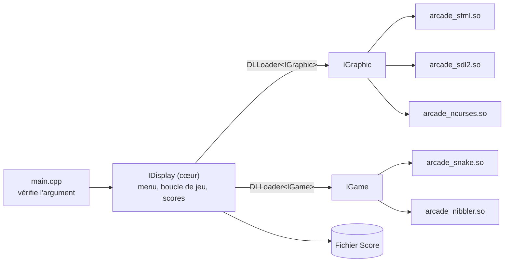

🇬🇧 [English](README.md) | 🇫🇷 Français

# Arcade

> Une plateforme de jeux modulaire en C++ qui charge les jeux et les moteurs de rendu comme bibliothèques partagées à l'exécution, pour changer de rendu (SFML, SDL2, NCurses) sans redémarrer.


## À propos

Arcade est un projet Epitech de programmation orientée objet (B-OOP-400). L'objectif est de séparer complètement la logique de jeu du rendu : un programme central charge des **bibliothèques graphiques** et des **bibliothèques de jeux** sous forme de plugins `.so` via `dlopen`, et les deux côtés ne communiquent qu'à travers des interfaces C++ abstraites. N'importe quel jeu tourne sur n'importe quel rendu, et le rendu peut être changé pendant l'exécution.

Le sujet original du projet se trouve dans [`doc/B-OOP-400_arcade.pdf`](doc/B-OOP-400_arcade.pdf), et une documentation complémentaire dans [`doc/Documentation.pdf`](doc/Documentation.pdf).

<!-- TODO: add screenshot -->

## Fonctionnalités principales

- **3 moteurs de rendu**, chacun compilé en bibliothèque partagée : SFML, SDL2 et NCurses (terminal).
- **2 jeux**, eux aussi compilés en bibliothèques partagées : Snake et Nibbler.
- **Chargement dynamique des plugins** grâce à un template générique `DLLoader<T>` basé sur `dlopen` / `dlsym`.
- **Changement de rendu à chaud** avec `F2` / `F3`, depuis le menu principal.
- **Scores persistants** : chaque partie terminée ajoute `jeu  joueur  score` au fichier `Score`, affiché dans le menu principal.
- **Cartes au format texte** (`resources/snake.txt`, `resources/nibbler.txt`) : `#` pour les murs, `o` pour la nourriture.
- **Pause, réinitialisation et minuteur de 200 ticks** dans chaque jeu.

## Stack technique

| Domaine | Technologie |
|---------|-------------|
| Langage | C++20 (`g++`, `-Wall -Wextra -Werror -fPIC`) |
| Graphisme | SFML (graphics, window, system, audio), SDL2 + SDL2_image + SDL2_ttf, NCurses |
| Chargement des plugins | POSIX `dlfcn.h` (`dlopen`, `dlsym`, `dlclose`) |
| Build | GNU Make |

## Choix techniques notables

- **Conception par interfaces.** `IGraphic` (rendu + entrées) et `IGame` (logique de jeu) sont des classes abstraites pures. Le cœur (`IDisplay`) ne connaît que ces interfaces.
- **Points d'entrée C pour les plugins.** Chaque bibliothèque exporte des fonctions `extern "C"` `create()` et `destroy()`, ce qui permet au cœur de les charger par nom de symbole sans subir le name mangling C++.
- **Entrées indépendantes du rendu.** Chaque moteur de rendu traduit ses événements clavier natifs vers une énumération commune `IDisplay` (`UP_KEY`, `F1_KEY`, `TWO`, ...), si bien que les jeux ne dépendent d'aucune bibliothèque graphique.
- **Repli des sprites pour le terminal.** Les jeux demandent des chemins d'images comme `resources/assets/wall.png` ; le moteur NCurses les convertit en caractères (`wall` → `#`, `player` → `@`, `apple` → `o`).

## Architecture



### Interfaces

`include/Interface/IGraphic.hpp`

```cpp
class IGraphic {
public:
    virtual ~IGraphic() = default;
    virtual void init() = 0;
    virtual void clearScreen() = 0;
    virtual void drawText(const std::string &text, int x, int y, int id) = 0;
    virtual void drawSprite(int x, int y, const std::string &sprite) = 0;
    virtual void refreshScreen() = 0;
    virtual int getInput() = 0;
    virtual bool isOpen() const = 0;
    virtual void close() = 0;
    virtual int *showMenu(const std::vector<std::string>& gameList,
                          const std::vector<std::string>& gamelib,
                          int scr1, int scr2) = 0;
};
```

`include/Interface/IGames.hpp`

```cpp
class IGame {
public:
    virtual ~IGame() = default;
    virtual void init() = 0;
    virtual std::vector<std::string> loadMap(const std::string &filename) = 0;
    virtual void update() = 0;
    virtual void handleInput(int key) = 0;
    virtual bool isGameOver() const = 0;
    virtual void reset() = 0;
    virtual int game(IGraphic *module, int *bestscore) = 0;
    virtual const char *getGameName() const = 0;
    virtual int getScore() const = 0;
};
```

### Moteurs de rendu

| Bibliothèque | Source | Fenêtre |
|--------------|--------|---------|
| `arcade_sfml.so` | `src/SFML/sfml.cpp` | 1920x1080, `resources/font.ttf` pour le texte |
| `arcade_sdl2.so` | `src/SDL/sdl.cpp` | 800x600, rendu accéléré matériellement, SDL_ttf + SDL_image |
| `arcade_ncurses.so` | `src/ncurses/ncurses.cpp` | Terminal, sprites affichés en caractères ASCII |

### Jeux

| Jeu | Règles (d'après le code) |
|-----|--------------------------|
| **Snake** | Le serpent grandit et gagne +10 points par pomme. Toucher un mur ou son propre corps termine la partie. Manger toutes les pommes termine aussi la partie. |
| **Nibbler** | Mêmes déplacements et même score que Snake, mais toucher un mur fait tourner le serpent au lieu de terminer la partie. |

## Démarrage

### Prérequis

- Linux (le chargeur utilise `dlfcn.h`)
- `g++` avec support de C++20, et `make`
- Les paquets de développement des **trois** bibliothèques graphiques. Le binaire `arcade` est lié à SFML, SDL2 et NCurses : elles sont toutes nécessaires, même si vous n'utilisez qu'un seul rendu :
  - SFML (`sfml-graphics`, `sfml-window`, `sfml-system`, `sfml-audio`)
  - SDL2, SDL2_image, SDL2_ttf
  - NCurses

Par exemple, sous Debian/Ubuntu :

```bash
sudo apt install g++ make libsfml-dev libsdl2-dev libsdl2-image-dev libsdl2-ttf-dev libncurses-dev
```

### Compilation

```bash
make            # compile le cœur, les bibliothèques graphiques et les jeux
```

| Cible | Résultat |
|-------|----------|
| `make core` | Exécutable `./arcade` |
| `make graphicals` | `lib/arcade_sfml.so`, `lib/arcade_sdl2.so`, `lib/arcade_ncurses.so` |
| `make games` | `lib/arcade_snake.so`, `lib/arcade_nibbler.so` |
| `make clean` | Supprime les fichiers objets |
| `make fclean` | Supprime aussi l'exécutable et les fichiers `.so` |
| `make re` | `fclean` puis `all` |

### Lancement

Lancez le programme depuis la racine du dépôt : les assets, les cartes et le fichier `Score` utilisent des chemins relatifs.

```bash
./arcade ./lib/arcade_sfml.so
./arcade ./lib/arcade_sdl2.so
./arcade ./lib/arcade_ncurses.so
```

L'argument doit être exactement l'un de ces trois chemins ; sinon le programme affiche les bibliothèques disponibles et se termine avec le code `84`.

## Utilisation

1. Au démarrage, saisissez votre nom de joueur dans le terminal (`Entrez votre nom de joueur:`).
2. Le menu principal s'ouvre dans le rendu choisi. Il liste les bibliothèques graphiques, les jeux et les scores enregistrés.
3. Choisissez un jeu, puis appuyez sur `Enter` pour jouer.

### Commandes

| Contexte | Touche | Action |
|----------|--------|--------|
| Menu | `F6` / `F7` | Changer le jeu sélectionné (Snake / Nibbler) |
| Menu | `Enter` | Lancer le jeu sélectionné |
| Menu | `F2` / `F3` | Bibliothèque graphique suivante / précédente |
| En jeu | `8` / `2` / `4` / `6` (pavé numérique en SFML et SDL2) | Haut / bas / gauche / droite |
| En jeu | `P` | Pause / reprise |
| En jeu | `R` | Réinitialiser la partie et le minuteur |
| En jeu | `F1` | Retour au menu |
| Partout | `Esc` | Fermer la fenêtre |

Une partie se termine sur un game over, avec `F1`, ou quand le minuteur de 200 ticks atteint zéro. Le score est alors ajouté au fichier `Score`.

## Structure du projet

```
Arcade/
├── Makefile
├── doc/                     # Sujet et documentation du projet (PDF)
├── include/
│   ├── Games/               # snake.hpp, nibbler.hpp
│   ├── Graphics/            # sfml.hpp, sdl.hpp, ncurses.hpp
│   └── Interface/           # IGraphic, IGames, IDisplay, DLLoader, Error, ScoreManager
├── lib/                     # Répertoire de sortie des plugins .so
├── resources/
│   ├── assets/              # Sprites et arrière-plans (PNG/BMP)
│   ├── font.ttf
│   ├── snake.txt            # Carte de Snake
│   └── nibbler.txt          # Carte de Nibbler
└── src/
    ├── main.cpp             # Point d'entrée et vérification de l'argument
    ├── IDisplay.cpp         # Cœur : menu, boucle de jeu, fichier de scores
    ├── SFML/  SDL/  ncurses/
    └── games/               # snake.cpp, nibbler.cpp
```

## Ajouter une bibliothèque

Pour ajouter un jeu ou un moteur de rendu, implémentez `IGame` ou `IGraphic` et exportez les deux points d'entrée C recherchés par le chargeur :

```cpp
extern "C" {
    IGame *create() { return new MyGame(); }
    void destroy(IGame *game) { delete game; }
}
```

Ajoutez ensuite une règle de compilation dans le `Makefile`. Attention : le cœur utilise actuellement des chemins de bibliothèques codés en dur dans `src/main.cpp` et `src/IDisplay.cpp`, il faut donc aussi y déclarer le nouveau chemin.

## Tests

Le dépôt ne contient pas de tests automatisés.

## Auteur

- Andy Sagbo ([@andysags](https://github.com/andysags))
