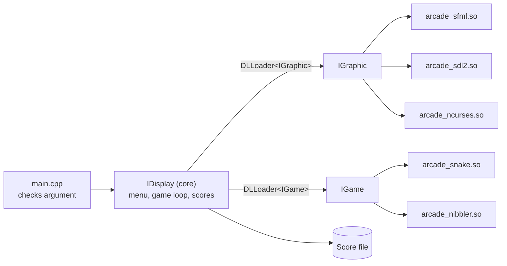

🇬🇧 English | 🇫🇷 [Français](README.fr.md)

# Arcade

> A modular C++ gaming platform that loads games and graphics back-ends as shared libraries at runtime, so you can switch renderer (SFML, SDL2, NCurses) without restarting.


## About

Arcade is an Epitech object-oriented programming project (B-OOP-400). The goal is to separate game logic from rendering completely: a core program loads **graphics libraries** and **game libraries** as `.so` plugins through `dlopen`, and both sides talk only through abstract C++ interfaces. Any game runs on any renderer, and you can swap the renderer while the program is running.

The original project specification is in [`doc/B-OOP-400_arcade.pdf`](doc/B-OOP-400_arcade.pdf), and extra documentation is in [`doc/Documentation.pdf`](doc/Documentation.pdf).

<!-- TODO: add screenshot -->

## Key features

- **3 graphics back-ends**, each compiled as its own shared library: SFML, SDL2 and NCurses (terminal).
- **2 games**, also compiled as shared libraries: Snake and Nibbler.
- **Runtime plugin loading** with a generic `DLLoader<T>` template built on `dlopen` / `dlsym`.
- **Hot-swap of the renderer** with `F2` / `F3`, from the main menu.
- **Persistent scores**: each finished game appends `game  player  score` to a `Score` file, shown in the main menu.
- **Text-file maps** (`resources/snake.txt`, `resources/nibbler.txt`) using `#` for walls and `o` for food.
- **Pause, reset and a 200-tick timer** in each game.

## Tech stack

| Area | Technology |
|------|------------|
| Language | C++20 (`g++`, `-Wall -Wextra -Werror -fPIC`) |
| Graphics | SFML (graphics, window, system, audio), SDL2 + SDL2_image + SDL2_ttf, NCurses |
| Plugin loading | POSIX `dlfcn.h` (`dlopen`, `dlsym`, `dlclose`) |
| Build | GNU Make |

## Notable technical choices

- **Interface-driven design.** `IGraphic` (rendering + input) and `IGame` (game logic) are pure abstract classes. The core (`IDisplay`) only knows these interfaces.
- **C entry points for plugins.** Every library exports `extern "C"` `create()` and `destroy()` functions, so the core loads them by symbol name without C++ name mangling.
- **Back-end-neutral input.** Each renderer converts its native key events into a shared `IDisplay` key enum (`UP_KEY`, `F1_KEY`, `TWO`, ...), so games never depend on a graphics library.
- **Sprite fallback for the terminal.** Games ask for image paths such as `resources/assets/wall.png`; the NCurses back-end maps them to characters (`wall` → `#`, `player` → `@`, `apple` → `o`).

## Architecture



### Interfaces

`include/Interface/IGraphic.hpp`

```cpp
class IGraphic {
public:
    virtual ~IGraphic() = default;
    virtual void init() = 0;
    virtual void clearScreen() = 0;
    virtual void drawText(const std::string &text, int x, int y, int id) = 0;
    virtual void drawSprite(int x, int y, const std::string &sprite) = 0;
    virtual void refreshScreen() = 0;
    virtual int getInput() = 0;
    virtual bool isOpen() const = 0;
    virtual void close() = 0;
    virtual int *showMenu(const std::vector<std::string>& gameList,
                          const std::vector<std::string>& gamelib,
                          int scr1, int scr2) = 0;
};
```

`include/Interface/IGames.hpp`

```cpp
class IGame {
public:
    virtual ~IGame() = default;
    virtual void init() = 0;
    virtual std::vector<std::string> loadMap(const std::string &filename) = 0;
    virtual void update() = 0;
    virtual void handleInput(int key) = 0;
    virtual bool isGameOver() const = 0;
    virtual void reset() = 0;
    virtual int game(IGraphic *module, int *bestscore) = 0;
    virtual const char *getGameName() const = 0;
    virtual int getScore() const = 0;
};
```

### Graphics back-ends

| Library | Source | Window |
|---------|--------|--------|
| `arcade_sfml.so` | `src/SFML/sfml.cpp` | 1920x1080, `resources/font.ttf` for text |
| `arcade_sdl2.so` | `src/SDL/sdl.cpp` | 800x600, hardware-accelerated renderer, SDL_ttf + SDL_image |
| `arcade_ncurses.so` | `src/ncurses/ncurses.cpp` | Terminal, sprites drawn as ASCII characters |

### Games

| Game | Rules (from the source) |
|------|-------------------------|
| **Snake** | The snake grows and scores +10 per apple. Hitting a wall or itself ends the game. Eating every apple also ends the game. |
| **Nibbler** | Same movement and scoring as Snake, but hitting a wall turns the snake instead of ending the game. |

## Getting started

### Prerequisites

- Linux (the loader uses `dlfcn.h`)
- `g++` with C++20 support and `make`
- Development packages for **all three** graphics libraries. The `arcade` binary links against SFML, SDL2 and NCurses, so you need all of them even if you only use one back-end:
  - SFML (`sfml-graphics`, `sfml-window`, `sfml-system`, `sfml-audio`)
  - SDL2, SDL2_image, SDL2_ttf
  - NCurses

For example, on Debian/Ubuntu:

```bash
sudo apt install g++ make libsfml-dev libsdl2-dev libsdl2-image-dev libsdl2-ttf-dev libncurses-dev
```

### Build

```bash
make            # builds the core, the graphics libraries and the game libraries
```

| Target | Output |
|--------|--------|
| `make core` | `./arcade` executable |
| `make graphicals` | `lib/arcade_sfml.so`, `lib/arcade_sdl2.so`, `lib/arcade_ncurses.so` |
| `make games` | `lib/arcade_snake.so`, `lib/arcade_nibbler.so` |
| `make clean` | Removes object files |
| `make fclean` | Also removes the executable and the `.so` files |
| `make re` | `fclean` then `all` |

### Run

Run from the repository root: assets, maps and the `Score` file use relative paths.

```bash
./arcade ./lib/arcade_sfml.so
./arcade ./lib/arcade_sdl2.so
./arcade ./lib/arcade_ncurses.so
```

The argument must be one of these three exact paths; otherwise the program prints the available libraries and exits with code `84`.

## Usage

1. At startup, type your player name in the terminal (`Entrez votre nom de joueur:`).
2. The main menu opens in the chosen back-end. It lists the graphics libraries, the games and the saved scores.
3. Pick a game, press `Enter` to play.

### Controls

| Context | Key | Action |
|---------|-----|--------|
| Menu | `F6` / `F7` | Switch the selected game (Snake / Nibbler) |
| Menu | `Enter` | Start the selected game |
| Menu | `F2` / `F3` | Next / previous graphics library |
| In game | `8` / `2` / `4` / `6` (numpad in SFML and SDL2) | Up / down / left / right |
| In game | `P` | Pause / resume |
| In game | `R` | Reset the game and the timer |
| In game | `F1` | Back to the menu |
| Anywhere | `Esc` | Close the window |

A game ends on game over, on `F1`, or when the 200-tick timer reaches zero. The score is then appended to `Score`.

## Project structure

```
Arcade/
├── Makefile
├── doc/                     # Project specification and documentation (PDF)
├── include/
│   ├── Games/               # snake.hpp, nibbler.hpp
│   ├── Graphics/            # sfml.hpp, sdl.hpp, ncurses.hpp
│   └── Interface/           # IGraphic, IGames, IDisplay, DLLoader, Error, ScoreManager
├── lib/                     # Output directory for the .so plugins
├── resources/
│   ├── assets/              # Sprites and backgrounds (PNG/BMP)
│   ├── font.ttf
│   ├── snake.txt            # Snake map
│   └── nibbler.txt          # Nibbler map
└── src/
    ├── main.cpp             # Entry point and argument check
    ├── IDisplay.cpp         # Core: menu, game loop, score file
    ├── SFML/  SDL/  ncurses/
    └── games/               # snake.cpp, nibbler.cpp
```

## Adding a library

To add a game or a renderer, implement `IGame` or `IGraphic` and export the two C entry points the loader looks for:

```cpp
extern "C" {
    IGame *create() { return new MyGame(); }
    void destroy(IGame *game) { delete game; }
}
```

Then add a build rule in the `Makefile`. Note that the core currently uses hard-coded library paths in `src/main.cpp` and `src/IDisplay.cpp`, so you must register the new path there too.

## Tests

The repository has no automated tests.

## Author

- Andy Sagbo ([@andysags](https://github.com/andysags))
